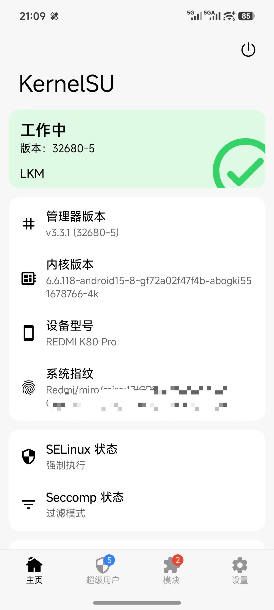

# Android 手机 Root 通用教程

一份从零开始、能照着一步步做的 Android Root 教程。以我自己实测的**小米 / 红米 / POCO（HyperOS，高通骁龙平台）**为例，把「解锁 Bootloader → 刷入 KernelSU → 验证」这条主线讲清楚，顺便解释每一步背后的原理——原理懂了，换一台机器你也能自己判断该怎么弄。

> 实测设备：代码名 `miro`，系统 `OS 3.0.303.0`，高通骁龙 8 平台。截图是这台机器 Root 成功后的状态。

## 这是什么

把自己给一台 HyperOS 手机 Root 的完整过程整理成文档。和其他只贴命令的教程不同，这里尽量回答「为什么要这么做」，尤其是三个容易让新手翻车的点：

- 为什么必须先解锁 Bootloader（AVB 校验链）
- 为什么补丁打的是 `init_boot.img` 而不是 `boot.img`
- KernelSU 和 Magisk 到底差在哪

## 文件说明

| 文件 | 内容 |
|---|---|
| [TUTORIAL.md](TUTORIAL.md) | 完整教程：前期准备、注意事项、分步流程、原理、常见问题、其他品牌说明 |
| [THANKS.md](THANKS.md) | 致谢，列出本教程用到的工具和它们的作者 |
| [DISCLAIMER.md](DISCLAIMER.md) | 免责声明（动手前务必先看） |
| [LICENSE](LICENSE) | 本教程文本的授权 |

## 极简版流程（一分钟看个大概）

1. 备份数据，装驱动、开 USB 调试
2. 解锁 Bootloader（小米用第三方工具，其他品牌走官方 OEM 解锁）
3. 用 KernelSU App 给原厂 `init_boot.img` 打补丁
4. `fastboot flash init_boot <补丁后的镜像>` 刷进去
5. 打开 KernelSU 看是否「已激活」

## 支持范围

- **实测可用**：小米 / 红米 / POCO，高通骁龙 8 Gen2 / 8 Gen3 / 8s Gen3 / 8 Elite 等，HyperOS / 澎湃 OS
- **思路通用**：任何能解锁 Bootloader 的 Android 手机，Root 的主线都一致，只是解锁方式、工具和镜像不同
- 文中的第三方解锁工具只针对小米 / 高通，其他品牌请走各自官方解锁通道（详见 TUTORIAL.md 末尾的「其他品牌说明」）

## 关于工具与下载

教程里用到的 KernelSU、QtScrcpy、adb / fastboot 都是开源免费的；小米解锁工具是酷安作者的第三方工具。作者名单见 [THANKS.md](THANKS.md)。

我把自己实际用到的工具（与教程版本一致）打包成了一个 Release，下载解压即可用：

- 📦 **工具包 v1.0**：<https://github.com/suyihang15/android-root-tutorial/releases/tag/v1.0>
  - 含 adb / fastboot、KernelSU APK、QtScrcpy、小米解锁工具、本教程对应的 init_boot 镜像
  - 每个文件都附了 SHA256 校验值，下载后可自行核对

> 仍然建议优先从作者官方渠道获取原版，避免二次打包风险。仓库 git 里不放二进制，全部在 Release。

> ⚠️ 解锁 Bootloader 会恢复出厂设置、清空全部数据，通常影响保修，并降低设备安全等级。动手前请完整阅读 [DISCLAIMER.md](DISCLAIMER.md) 和教程里的「注意事项」，备份好自己的数据。
